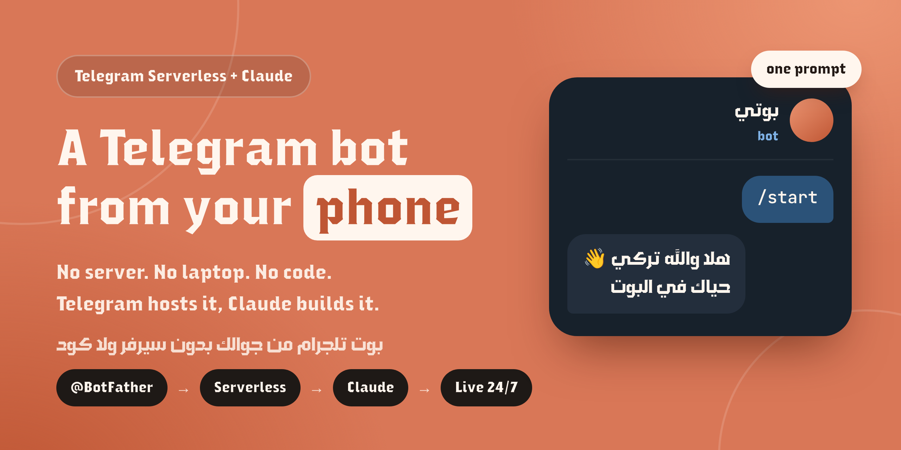

<p align="center"></p>

# A Telegram bot from your phone

**No server. No laptop. No code.** Telegram hosts the bot, Claude writes and deploys it.

[العربية](README.ar.md)

Telegram now has **Serverless**, which runs your bot inside Telegram's own cloud. You don't have to rent a VPS, set up webhooks or keep a process running. Claude can write the code and deploy it from a chat, so a phone is all you need.

This guide goes from zero to a bot that greets people by name, then adds a Mini App.

---

## What "Serverless" means

- **Your code lives in Telegram's cloud.** It only runs when someone messages the bot, so there's nothing for you to keep online.
- **Each bot gets a built-in database.** There's nothing to install.
- **Mini Apps are hosted for you** on a link like `https://app<id>.tgcloud.ai/`.
- **JavaScript only.** That's fine, because the AI writes it.

---

## Step 1: Create the bot

Open [@BotFather](https://t.me/BotFather), send `/newbot`, and give it a name and a username that ends in `bot`.

## Step 2: Turn on Serverless

In BotFather, open your bot, then go to **Settings**, then **Serverless**, and turn the switch on.

> Telegram sometimes takes a while to approve and activate it. If it doesn't work right away, come back later.

## Step 3: Copy your keys

Once Serverless is on, open **CLI Access** and copy two things:

1. **The install command.** It already contains your bot's name:
   ```
   npm create @tgcloud/bot YourBotName
   ```
2. **The Access token.**

> ⚠️ The **Access token is not the normal bot token** BotFather gave you when you created the bot. It's a separate token for Serverless, and it's the one you need here. Don't share it with anyone.

## Step 4: Let Claude reach Telegram

Claude works inside a sandbox, and by default the sandbox can't reach Telegram's servers.

On **claude.ai**, open **Settings**, then **Capabilities**:

- Turn on **Allow network egress**
- Set the **Domain allowlist** to **All domains**

Then **start a new chat** so the setting takes effect. This is available on paid plans. The free plan only allows package managers.

## Step 5: One prompt builds everything

Paste this into the new chat, with your own command and token:

```
Build me a Telegram bot on Telegram Serverless from scratch
Install command: npm create @tgcloud/bot YourBotName
Access token: <paste your Access token here>
Run the install command and read AGENTS.md first
Don't use the login command, use the TGCLOUD_TOKEN environment variable instead, together with NODE_USE_ENV_PROXY=1
Make the bot reply to any message with "Hey" plus the person's first name, then "Welcome to the bot"
Test it, then deploy it to Telegram
```

Why the prompt is written this way:

| Line | Why |
|---|---|
| `read AGENTS.md` | The project includes a file that explains the platform's rules to AI coding tools, so they work correctly from the first message. |
| `TGCLOUD_TOKEN` instead of `login` | `tgcloud login` is interactive: it waits for you to type the token by hand, and an AI agent can't do that. The CLI reads the token from this variable instead. |
| `NODE_USE_ENV_PROXY=1` | Claude's sandbox reaches the internet through a proxy, and Node doesn't use it by default. Without this, deploying fails with "Could not reach the tgcloud server". |

Claude then creates the project, writes the handler, tests it with `npx tgcloud run`, and deploys it with `npx tgcloud push`.

## Step 6: Try it

Open your bot and send `/start`:

```
You:  /start
Bot:  Hey Turki 👋
      Welcome to the bot
```

The bot now runs 24/7 on Telegram, even after you close the chat. To change it later, tell Claude what you want and it redeploys.

---

## Bonus: Add a Mini App

In BotFather, under **Serverless**, there's a **Mini App Files** section. It stays empty until you upload a front end. In the same chat, tell Claude:

```
Build me a simple Mini App that greets the user by name, deploy it with the bot, and make the bot's menu button open it
```

Claude builds the front end, deploys it with the bot, and the Mini App opens right inside Telegram.

What's going on underneath:
- `tgcloud.jsonc` → `"static": { "source": "dist" }` tells Telegram which build folder to host.
- The front end must be **built before pushing**, because `push` uploads the folder as-is.
- Server-side logic for the Mini App goes in `tgcloud/endpoints/<name>.js`. It's called with `Telegram.WebApp.Serverless.call('<name>', input, callback)`, and Telegram verifies the user's init data before your code runs.

---

## Prefer your own machine?

The same flow works with **Claude Code** or **Codex** on a laptop or your own server. Install one of them and give it the same prompt.

```bash
# Claude Code: macOS / Linux
curl -fsSL https://claude.ai/install.sh | bash
# Claude Code: Windows (PowerShell)
irm https://claude.ai/install.ps1 | iex
# Codex (needs Node.js)
npm i -g @openai/codex
```

On your own machine, `NODE_USE_ENV_PROXY=1` usually isn't needed.

---

## Project layout (for the curious)

```
YourBotName/
├── AGENTS.md              # rules for AI coding tools
├── docs/tgcloud-sdk.md    # full SDK reference
├── tgcloud.jsonc          # Mini App hosting config
└── tgcloud/
    ├── schema.js          # database tables
    ├── handlers/          # message.js, callback_query.js, …
    ├── endpoints/         # functions your Mini App calls
    └── lib/               # shared code
```

Limits to keep in mind: no npm packages inside the bot code (only the built-in SDK), no filesystem, and no foreign keys in the database.

---

## Where to go next

Once the foundation works, everything else is a matter of describing what you want: buttons and menus, a database, a store, games, Telegram Stars subscriptions, or an admin panel.

- Official docs: [core.telegram.org/bots/serverless](https://core.telegram.org/bots/serverless)
- Example bots: [mititgcloudbot](https://github.com/tiennm99dev/mititgcloudbot) · [telegram-bot-serverless](https://github.com/RSaied/telegram-bot-serverless)

---

Made by [@tu_u_k](https://www.tiktok.com/@tu_u_k) · Telegram: [t.me/ma99za0](https://t.me/ma99za0)
